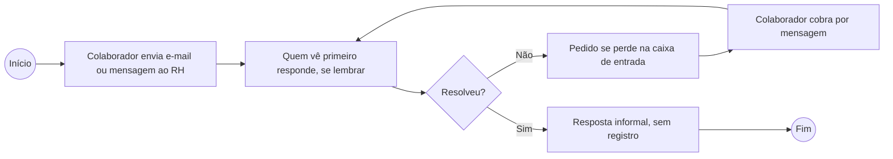
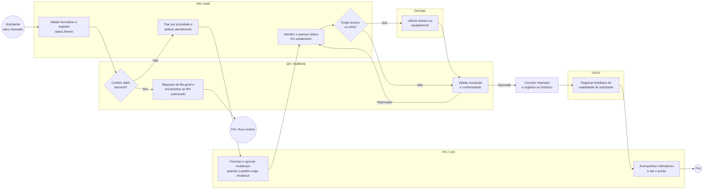

# Processo de chamados — AS-IS e TO-BE (BPMN)

Os diagramas abaixo usam a notação BPMN (eventos de início/fim, tarefas, gateways e raias) escritos em Mermaid, que o GitHub renderiza direto neste arquivo. As **raias do TO-BE são exatamente os papéis da [matriz RACI](raci.md)**.

## AS-IS — como era (e-mail e mensagens avulsas)

**Dores:** sem fila visível, sem prioridade, sem responsável definido, sem registro nem medição de prazo, dados pessoais soltos em e-mails.

## TO-BE — como fica com o GovDesk

### Etapas e donos

| # | Etapa | Raia (papel RACI) | Onde aparece no sistema |
|---|-------|-------------------|--------------------------|
| 1 | Abrir chamado com validação e aviso LGPD | Dev Lead (sistema) | Formulário `/novo` |
| 2 | Checar dado sensível | QA / Auditoria | Aviso, ciência obrigatória e bloqueio de CPF |
| 3 | Triar por prioridade | Dev Lead | Lista ordenada por prioridade |
| 4 | Priorizar / aprovar mudança, se houver | PO / CIO | [template-mudanca.md](template-mudanca.md) |
| 5 | Atender (status **Em andamento**) | Dev Lead | Botão "Iniciar atendimento" |
| 6 | Acesso ou infraestrutura, se necessário | DevOps | — |
| 7 | Validar resolução | QA / Auditoria | Botão "Concluir" só após validação |
| 8 | Concluir e registrar histórico | Dev Lead | Status **Concluído** + histórico do chamado |
| 9 | Feedback de usabilidade | UX/UI | Backlog de melhorias |
| 10 | Acompanhar indicadores e aceite | PO / CIO | Página **Indicadores** |

**Ganhos esperados:** fila única e visível, prioridade explícita, responsável por etapa, histórico auditável e MTTR medido (meta &lt; 24 h, ver [peti.md](peti.md)).
